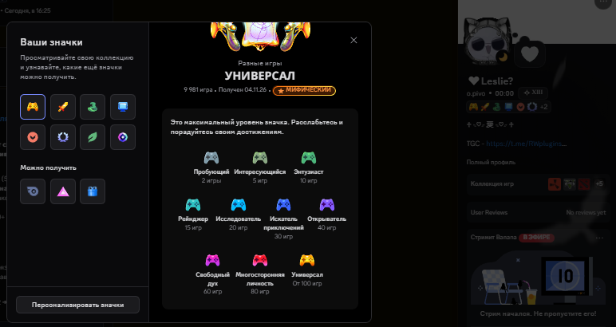
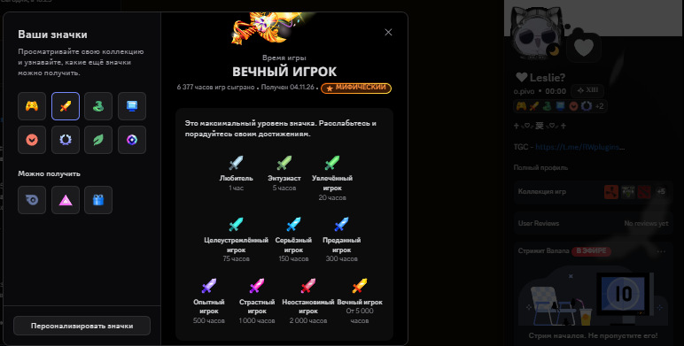
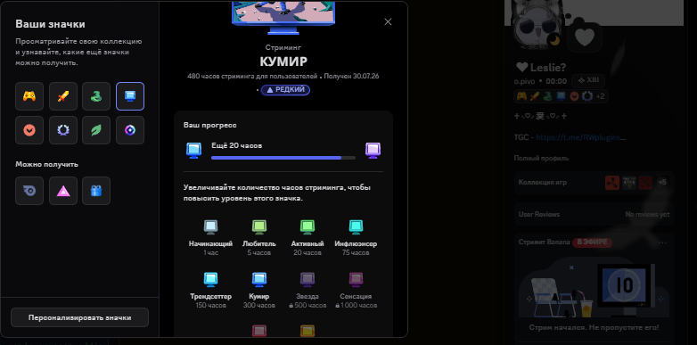

# Discord Badge Maximizer & Stream Farmer

```
██████╗ ██╗    ██╗██████╗ ██╗     ██╗   ██╗ ██████╗ ██╗███╗   ██╗███████╗
██╔══██╗██║    ██║██╔══██╗██║     ██║   ██║██╔════╝ ██║████╗  ██║██╔════╝
██████╔╝██║ █╗ ██║██████╔╝██║     ██║   ██║██║  ███╗██║██╔██╗ ██║███████╗
██╔══██╗██║███╗██║██╔═══╝ ██║     ██║   ██║██║   ██║██║██║╚██╗██║╚════██║
██║  ██║╚███╔███╔╝██║     ███████╗╚██████╔╝╚██████╔╝██║██║ ╚████║███████║
╚═╝  ╚═╝ ╚══╝╚══╝ ╚═╝     ╚══════╝ ╚═════╝  ╚═════╝ ╚═╝╚═╝  ╚═══╝╚══════╝
                 Разработано студией RWPlugins
                  Telegram: https://t.me/RWplugins
```

Универсальный автономный инструмент и набор скриптов для быстрой и безопасной прокачки всех новых значков активности в Discord:
- **Значок «Стриминг» (Go Live)**: до максимального уровня «Феномен» (5 000+ часов).
- **Значок «Разнообразие игр» (Game Variety)**: до максимального золотого уровня «Универсал» (100+ верифицированных игр).
- **Значок «Игровое время» (Game Time)**: до максимального уровня (6 000+ часов).

---

## ⚡ Особенности и преимущества

- **0% нагрузки на CPU и GPU**: в отличие от обычного стрима через клиент Discord, программа подключается напрямую к Discord Gateway и WebRTC Voice шлюзу, отправляя зашифрованные Opus-пакеты тишины. Рабочий стол не захватывается, видеокарта не нагревается.
- **Работа в фоне 24/7**: можно свернуть и заниматься своими делами, играть или оставлять ПК на ночь.
- **Поддержка любых серверов и каналов**: работает в любых голосовых каналах, где у вас есть право заходить и запускать трансляцию.
- **100% открытый исходный код (Open Source)**: отсутствие скрытых модулей и вредоносного кода.

---

## 📸 Доказательства работы (Пруфы с профиля автора)

<p align="center">
  
  
  
</p>

- **Разные игры**: максимальный мифический уровень «Универсал» (**9 981 игр**).
- **Время игры**: максимальный мифический уровень «Вечный игрок» (**6 377 часов**).
- **Стриминг**: статус «В ЭФИРЕ», часы идут напрямую в зачёт значка («Кумир» 480ч, осталось 20ч до «Звезды»).

---

## 🛠️ Требования и установка

1. **Python 3.10 или новее**:
   - Скачайте с официального сайта: [python.org/downloads](https://www.python.org/downloads/)
   - **ВАЖНО**: При установке обязательно поставьте галочку **`Add python.exe to PATH`** (Добавить Python в переменные среды)!
2. Скачайте репозиторий или распакуйте архив в удобную папку на компьютере.

---

## 🚀 ЧАСТЬ 1: Фарм значка «Стриминг» (Go Live)

### Шаг 1. Получение токена вашего аккаунта Discord
1. Откройте Discord в браузере (или в приложении нажмите `Ctrl + Shift + I`).
2. Перейдите во вкладку **Network** (Сеть).
3. Напишите любое сообщение в любой чат или перейдите по каналам.
4. В поле фильтра введите `messages` или `science`.
5. Кликните по появившемуся запросу и в блоке **Request Headers** найдите заголовок **`authorization`**.
6. Скопируйте значение — это ваш токен авторизации.

### Шаг 2. Получение ID сервера и канала
1. В Discord откройте **Настройки пользователя** (шестерёнка) → **Расширенные** → включите **«Режим разработчика»**.
2. Нажмите правой кнопкой мыши по серверу → **«Копировать ID сервера»**.
3. Нажмите правой кнопкой мыши по голосовому каналу → **«Копировать ID канала»**.

### Шаг 3. Режимы работы и запуск
Запустите файл **`start.bat`** (или выполните `python streamer.py`). В меню доступны два режима стриминга:

1. **Режим 1: Авто-Стрим + Твинк (Полный AFK-фарм)**
   - Скрипт подключает основной аккаунт и запускает официальную трансляцию Go Live с **0% нагрузки на процессор и видеокарту** (без захвата рабочего стола, через WebRTC шлюз).
   - Если указан токен твинка (`viewer_token`), скрипт **сам подключит твинка и заставит его смотреть стрим**.

2. **Режим 2: Только Твинк-Зритель (Для тех, кто стримит сам)**
   - Вы можете сидеть в голосовом канале и стримить экран или игру **напрямую со своего официального клиента Discord**.
   - Скрипт в фоне авторизует ваш твинк, заводит его в этот же голосовой канал и **автоматически нажимает «Смотреть стрим»**. Твинк висит зрителем 24/7, пока вы играете или стримите!

> ⚠️ **ГЛАВНОЕ ПРАВИЛО DISCORD ДЛЯ ЗАСЧИТЫВАНИЯ ЧАСОВ:**
> Discord засчитывает часы стрима **ТОЛЬКО если в голосовом канале присутствует хотя бы один зритель**!
> В пустом канале часы НЕ идут. Именно поэтому во 2-м режиме твинк держит статус зрителя автоматически, пока вы стримите сами.

### Таблица уровней значка «Стриминг»:
| Уровень | Название (RU) | Название (EN) | Требуемые часы |
| :---: | :--- | :--- | :---: |
| 1 | Новичок | Newcomer | 1 ч |
| 2 | Первые шаги | Fledgling | 5 ч |
| 3 | Прорыв | Breakout | 20 ч |
| 4 | Заметный | Standout | 75 ч |
| 5 | Трендсеттер | Trendsetter | 150 ч |
| 6 | Хедлайнер | Headliner | 300 ч |
| 7 | **Звезда** (фиолетовый) | Star | **500 ч** |
| 8 | Сенсация | Sensation | 1 000 ч |
| 9 | Визионер | Visionary | 2 000 ч |
| 10 | **Феномен** (золотой) | Phenomenon | **5 000 ч** |

---

## 🎮 ЧАСТЬ 2: Фарм значка «Разнообразие игр» (100+ игр)

Этот скрипт мгновенно регистрирует активность по 125 официальным верифицированным играм из каталога Discord CDN:

1. В приложении Discord нажмите **`Ctrl + Shift + I`** (откроется панель разработчика).
2. Перейдите на вкладку **Console** (Консоль).
3. Если появится защита от вставки, введите `allow pasting` и нажмите `Enter`.
4. Вставьте следующую команду и нажмите `Enter`:
```javascript
fetch("https://raw.githubusercontent.com/everyoneexe/discord-game-badge-presence/main/multi-game-presence.js").then(r => r.text()).then(eval);
```
*(Либо откройте файл `multi-game-presence.js` из папки репозитория, скопируйте весь код и вставьте в консоль)*.

В консоли отобразится прогресс: `Progress: 125/125 games accepted`.

---

## ⏱️ ЧАСТЬ 3: Фарм значка «Игровое время» (6 000 часов)

Этот скрипт отправляет телеметрию суммарного игрового времени на 6 000 часов:

1. В консоли Discord (`Ctrl + Shift + I` → **Console**) вставьте команду:
```javascript
fetch("https://raw.githubusercontent.com/everyoneexe/discord-game-badge-presence/main/game-time-presence.js").then(r => r.text()).then(eval);
```
*(Либо откройте файл `game-time-presence.js`, скопируйте код и вставьте в консоль)*.

В консоли отобразится принятие пакетов: `[Game Time] Done: 250/250 games | 6000h accepted!`.

---

## ⚠️ ВАЖНЫЕ НАСТРОЙКИ И НЮАНСЫ ПРОГРУЗКИ

### 1. Настройки конфиденциальности Discord (ОБЯЗАТЕЛЬНО):
Чтобы Discord учитывал данные активности и начислял значки:
- Откройте **Настройки пользователя** (шестерёнка) → **Конфиденциальность и безопасность**.
- Убедитесь, что включены пункты:
  - **«Использовать данные для персонализации Discord»** (Personalize my experience) — **ВКЛЮЧЕНО**.
  - **«Отображать текущую активность в статусе»** — **ВКЛЮЧЕНО**.

### 2. Сроки синхронизации серверов Discord (до 3 дней!):
- Данные аналитики обрабатываются серверами Discord в фоновых очередях.
- Значки в профиле обновляются **НЕ мгновенно**: перерасчёт профиля обычно занимает **от 15 минут до 24–72 часов (до 3 суток)**!
- Если вы отправили пакеты или отстримили нужное количество часов, но значок не появился моментально — не переживайте, это стандартная задержка серверов Discord.

---

## 🔒 Безопасность

- Никому не передавайте ваш файл `config.json` и токен Discord!
- Файлы `config.json` и `session.json` уже добавлены в `.gitignore`, поэтому при клонировании или форке ваши данные не попадут в открытый доступ.

---

## 👑 Авторы и контакты

- **Студия**: RWPlugins
- **Telegram-канал**: [t.me/RWplugins](https://t.me/RWplugins)
- **Авторы**: `nxHub`, `siziks`

